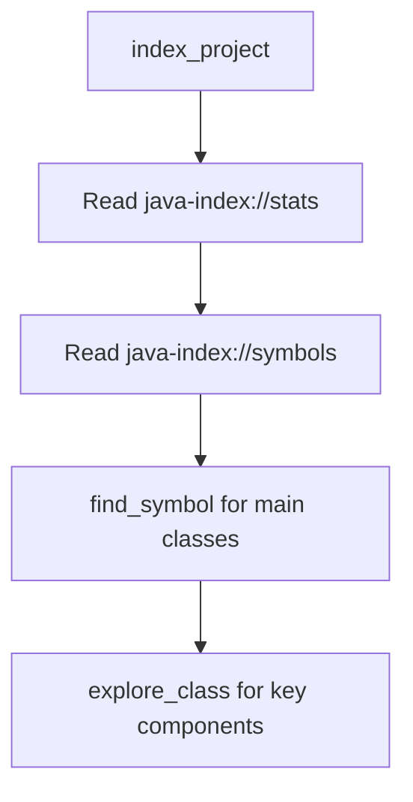
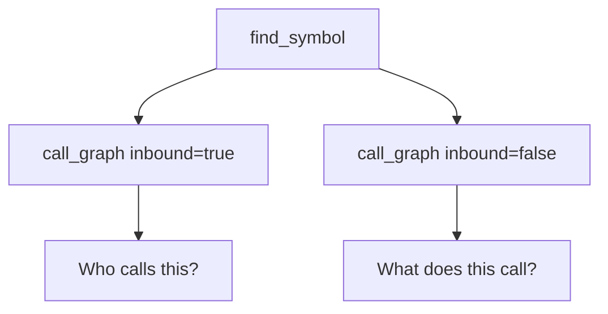

# Agent Integration Guide

This document provides comprehensive guidance for AI agents using the MCP Java Indexer.

## Quick Start for Agents

### 1. Index the Project First
Always start by indexing the codebase:
```
index_project(rootDir: "/path/to/project")
```

### 2. Explore with Resources
Check what's available via MCP Resources:
- `java-index://stats` - Index statistics and health
- `java-index://symbols` - Symbol summary by type/package
- `java-index://files` - List of indexed files

### 3. Use the Right Tool for the Task
| Task | Tool |
|------|------|
| Find a class/method | `find_symbol` |
| See who uses something | `find_usages` |
| Trace execution flow | `call_graph` |
| Deep dive into a class | `explore_class` |
| Multiple quick lookups | `batch_query` |
| Search code content | `search_text` |

---

## FQN (Fully Qualified Name) Reference

Understanding FQNs is critical for effective tool usage.

### FQN Formats

| Type | Format | Example |
|------|--------|---------|
| Class | `package.ClassName` | `com.example.UserService` |
| Method | `package.Class.method(ParamTypes)` | `com.example.UserService.findById(Long)` |
| Constructor | `package.Class.<init>(ParamTypes)` | `com.example.User.<init>(String,String)` |
| Field | `package.Class.fieldName` | `com.example.User.email` |
| Static method | `package.Class.method(ParamTypes)` | `java.util.Arrays.asList(Object[])` |

### Parameter Type Conventions

- Primitives: `int`, `long`, `boolean`, `double`, etc.
- Arrays: `String[]`, `int[]`, `Object[]`
- Generics: Use raw type - `List` not `List<String>`
- Varargs: Treated as arrays - `String...` becomes `String[]`
- No params: Empty parens - `method()`

### Common Patterns

```
# Finding constructors
find_symbol(name: "User.<init>")
find_symbol(name: "com.example.User.<init>(String)")

# Finding overloaded methods
find_symbol(name: "process")  # Returns all overloads
call_graph(fqn: "com.service.Processor.process(String)")  # Specific overload

# Finding inner classes
find_symbol(name: "OuterClass.InnerClass")
find_symbol(name: "com.example.OuterClass$InnerClass")
```

---

## Recommended Workflows

### Understanding a New Codebase



1. **Index**: `index_project(rootDir: "...")`
2. **Survey**: Read `java-index://stats` resource
3. **Identify Entry Points**: Find main classes, controllers, services
4. **Deep Dive**: Use `explore_class` on important components

### Finding Where Code is Used


1. **Locate**: `find_symbol(name: "methodName")`
2. **Get FQN**: Copy the fully qualified name from results
3. **Find Usages**: `find_usages(fqn: "exact.fqn.from.step.2")`

### Tracing Execution Flow



1. **Find Method**: `find_symbol(name: "processOrder")`
2. **Callers**: `call_graph(fqn: "...", inbound: true)` - Who calls this?
3. **Callees**: `call_graph(fqn: "...", inbound: false)` - What does this call?
4. **Full Chain**: `call_graph(fqn: "...", depth: 3)` - Multi-level trace

### Safe Refactoring

Use the `refactor-safely` prompt:
```
get_prompt(name: "refactor-safely", arguments: {symbolFqn: "com.example.OldName"})
```

This returns a structured workflow:
1. Find all usages
2. Identify callers (inbound)
3. Identify dependencies (outbound)
4. List files to modify

---

## Tool Categories

### 🔍 Discovery Tools (Safe to call anytime)
- `find_symbol` - Locate classes, methods, fields
- `find_usages` - Find all references
- `search_text` - Full-text code search
- `explore_class` - Comprehensive class analysis

### 📊 Analysis Tools (Read-only)
- `call_graph` - Trace method calls
- `explain_code` - Get code explanations
- `get_class_hierarchy` - Inheritance analysis

### 🔧 Indexing Tools (May take time)
- `index_project` - Full project index (run once)
- `reindex_file` - Update single file (fast)

### ⚡ Efficiency Tools (Reduce round trips)
- `batch_query` - Multiple queries in one call
- `explore_class` - All-in-one class analysis

---

## Batch Query Examples

Reduce API calls by batching:

```json
batch_query({
  "queries": [
    {"type": "find_symbol", "params": {"name": "UserService"}},
    {"type": "find_symbol", "params": {"name": "OrderService"}},
    {"type": "find_symbol", "params": {"name": "PaymentService"}}
  ]
})
```

Supported query types:
- `find_symbol` - params: `{name: string}`
- `find_usages` - params: `{fqn: string}`
- `call_graph` - params: `{fqn: string, inbound?: boolean, depth?: number}`
- `explain_code` - params: `{fqn: string}`
- `goto_definition` - params: `{fqn: string}`

---

## Best Practices

### ✅ Do

1. **Index first** - Always run `index_project` before other tools
2. **Use exact FQNs** - Copy FQNs from `find_symbol` results
3. **Check resources** - Use `java-index://stats` to verify index health
4. **Batch when possible** - Use `batch_query` for multiple lookups
5. **Use explore_class** - One call vs 4-5 separate calls

### ❌ Don't

1. **Don't guess FQNs** - Use `find_symbol` to discover them
2. **Don't skip indexing** - Tools return empty results without index
3. **Don't over-specify** - Simple name often works for unique symbols
4. **Don't ignore hints** - Tool annotations indicate safety (readOnly, idempotent)

---

## Tool Annotations Reference

All tools have annotations indicating their behavior:

| Annotation | Meaning |
|------------|---------|
| `readOnlyHint: true` | Tool doesn't modify anything |
| `idempotentHint: true` | Safe to call multiple times |
| `destructiveHint: true` | May overwrite existing data |

### Annotation by Tool

| Tool | Read Only | Idempotent | Destructive |
|------|-----------|------------|-------------|
| find_symbol | ✅ | ✅ | ❌ |
| find_usages | ✅ | ✅ | ❌ |
| call_graph | ✅ | ✅ | ❌ |
| search_text | ✅ | ✅ | ❌ |
| explore_class | ✅ | ✅ | ❌ |
| batch_query | ✅ | ✅ | ❌ |
| index_project | ❌ | ✅ | ✅ |
| reindex_file | ❌ | ✅ | ❌ |

---

## Prompts Reference

Reusable workflow prompts available via `GetPrompt`:

### understand-class
Deep dive into a class's role and relationships.
```
Arguments: {className: "UserService"}
```

### refactor-safely  
Step-by-step refactoring impact analysis.
```
Arguments: {symbolFqn: "com.example.OldClass"}
```

### find-pattern
Find all implementations of a pattern.
```
Arguments: {pattern: "Repository", description: "data access layer classes"}
```

### trace-flow
Trace execution from entry to exit.
```
Arguments: {entryPoint: "com.api.Controller.handleRequest(Request)"}
```

---

## Troubleshooting

### "Symbol not found"
1. Verify project is indexed: Check `java-index://stats`
2. Try partial name: `find_symbol(name: "ClassName")` without package
3. Check spelling: Search with `search_text` first

### "Empty call graph"
1. Verify FQN is exact (copy from find_symbol result)
2. Method might have no callers/callees
3. Try `inbound: true` to find callers

### "Index out of date"
1. Run `reindex_file` for changed files
2. Or re-run `index_project` for full refresh

### "Too many results"
1. Use more specific name
2. Add package prefix: `com.example.User` instead of `User`
3. Filter by kind if supported

---

## Version

This guide applies to MCP Java Indexer v2.3.0+

Features documented:
- ✅ Resources API (stats, symbols, files)
- ✅ Prompts API (4 workflow prompts)
- ✅ Tool Annotations (readOnly, idempotent, destructive hints)
- ✅ Server Instructions
- ✅ Composite Tools (explore_class, batch_query)
